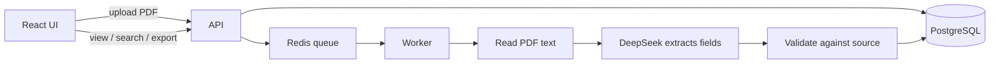

# Architecture

## The problem

QBR reports from different teams don't share a structure. The same information can appear under different headings, in tables or in free text, or not at all. The goal is to turn every report into **one consistent record**, and to say clearly when something is missing or uncertain instead of guessing.

## How it works

1. **Upload.** The API checks that the file is a real PDF, stores it, and creates a processing run in the database. Uploading the same file twice reuses the existing result.
2. **Queue.** The run goes to a background worker through a Redis queue, so the API responds immediately and slow model calls don't block it.
3. **Read the PDF.** The worker extracts text page by page and keeps the page numbers.
4. **Extract.** The LLM receives the numbered pages and a fixed prompt, and returns JSON in a strict schema. Every value must include an **exact quote** from the document and its page number.
5. **Validate.** Code (not the model) checks the output:
   - Each quote must appear verbatim on the page it cites. If it doesn't, the value is marked `unverified`.
   - Numbers must match the text they came from.
   - Dates are normalized only when they are unambiguous ("July 2026" becomes `2026-07`; "22 July" stays as written).
   - Two different exact values for the same KPI and period are marked as a conflict.
6. **Save.** The full result is stored as JSON, with KPIs and action items also in their own tables for querying. A run with no problems is `completed`; a run with issues is `needs_review`.

## Handling uncertainty

Every extracted field has a **status**, not just a value:

| Status | Meaning |
|---|---|
| `supported` | Stated in the document and backed by a verified quote |
| `missing` | Not in the document (e.g. no owner for a task) |
| `ambiguous` | Can be read more than one way (e.g. a quarter with no year) |
| `conflicting` | The document gives contradictory values; all candidates are kept |
| `unverified` | The model's quote couldn't be found in the source |

Each finding is also graded `error`, `warning` or `info`, so a reviewer sees the real problems first. For example, a task with no deadline is a warning, while a KPI with no stated population scope is only informational.

I chose explicit statuses over a confidence score because a model's self-reported confidence isn't reliable. A quote that can be checked is.

## Output schema

Defined once in `shared/src/index.ts` and used by the server and the UI:

customer · reporting period · executive summary · goals · KPIs (with current / previous / target values, units and period) · achievements · challenges · risks · action items (with owner and due date)

## Technology choices

| Choice | Why | Alternative / when to revisit |
|---|---|---|
| TypeScript on Node.js | One language and shared types across server, UI and schema | A separate Python service if PDF parsing gets complex |
| A fixed LLM pipeline, not an agent | The steps are known in advance, which makes them predictable and testable | An agent makes sense for open questions across many reports |
| DeepSeek via AI SDK + Zod | Cheap, good at structured output; the SDK makes switching providers easy; Zod enforces the schema | Swap the model if accuracy requires it |
| Whole document in one call, no RAG | QBRs are short, and splitting them risks missing a goal or a risk | Chunking for long documents |
| PostgreSQL (JSON + tables) | Keeps the full record and still supports SQL queries on KPIs and tasks | Fine as is for a POC |
| Redis queue (BullMQ) | Background processing, automatic retries, and rate limiting of model calls | A database-backed queue would be simpler |
| `pdf-parse` | Runs in Node and works well on the sample PDFs | Docling or a managed parser for scans and complex tables |

## Reliability

- Temporary failures (network, provider) are retried up to 3 times. Permanent ones (bad PDF, missing key) fail immediately with a clear message and can be retried from the UI.
- Reprocessing a run replaces its data instead of duplicating it.
- If the API crashes after saving a run but before queueing it, the worker picks it up from the database.

## Not included

- OCR for scanned documents
- Authentication or multi-user support
- Cloud file storage (files are stored on local disk)
- Testing on reports beyond the six samples. The next step would be new variations: different layouts, scans, complex tables.
